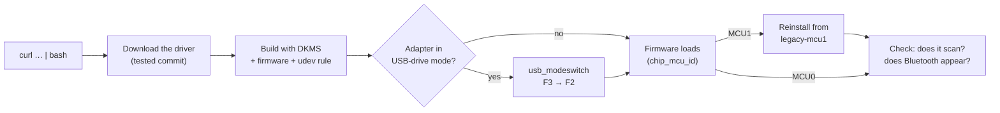

<p align="center"></p>

<h1 align="center">aic8800-wifi6-linux</h1>

<p align="center">
  <a href="README.md">Español</a> · <b>English</b><br><br>
  <a href="https://cafecito.app/matcarfer">☕ Cafecito</a> · <a href="https://www.matecito.co/matcarfer">🧉 Matecito</a> · <a href="https://link.mercadopago.com.ar/matcarfer">💙 Mercado Pago</a> · <a href="https://ko-fi.com/matcarfer">☕ Ko-fi</a> · <a href="https://www.patreon.com/matcarfer">❤ Patreon</a>
</p>

<p align="center"><b>Get the Wi-Fi 6 + Bluetooth USB adapter that "shows up as a USB drive" working on Linux, with one command.</b></p>

```bash
curl -fsSL https://raw.githubusercontent.com/matcarfer/aic8800-wifi6-linux/main/install.sh | bash
```

It asks for your password, builds the driver (3–6 minutes), and ends like this:

```
==> Looking for the adapter...
  It is in USB-drive mode (1111:1111). Switching to Wi-Fi mode...
  ✓ Adapter in Wi-Fi mode (a69c:8d81)
  ✓ Wi-Fi: wlan0 sees 31 networks
  ✓ Bluetooth: hci1

Done. The adapter activates by itself every time you plug it in.
```

No unplugging needed. The driver rebuilds itself on every new kernel.

---

## Is this my adapter?

Most likely, if when you plug it into Linux **no new network shows up**, but **a USB drive or CD called "WiFi Driver"** does, with a `Wifi6_install.exe` inside.

To be sure, run `lsusb`:

| `lsusb` shows | What it is |
|---|---|
| `1111:1111 Pandora International Ltd. 88M80` | AIC8800D80 in USB-drive mode (generic "WIFI6", Lukton, AX900…) |
| `a69c:5721` … `a69c:5732` | AIC8800 in USB-drive mode (Tenda, UGREEN, Cudy, BrosTrend…) |
| `a69c:8d80`, `a69c:8d81`, `368b:8d81`, … | The same adapter, already in Wi-Fi mode |

Sold as **AX300, AX900, AX1800 or "WiFi 6 + Bluetooth 5.x"**: Tenda U11, UGREEN AX900, BrosTrend AX300/AX900, TP-Link TX1U Nano, and many generic adapters from AliExpress and Amazon. The full ID list is in [`install.sh`](install.sh) (`STORAGE_IDS` and `WIFI_IDS`).

## Why doesn't it just work?

<details>
<summary>The short explanation (open)</summary>

1. **It pretends to be a USB drive.** So that Windows users can install the driver without a CD, the adapter boots disguised as a drive holding the `.exe` installer. To become a Wi-Fi adapter it needs a special command: two AIC SCSI messages ending in `F3` and `F2`. Linux doesn't know them.
2. **Linux doesn't ship the driver.** The AIC8800 chip is not in the mainline kernel. The driver must be built, the chip firmware loaded, and the driver rebuilt for every new kernel.
3. **Bluetooth needs the firmware loaded** before it shows up. After that, Linux's standard `btusb` handles it.

This repo solves all three with one command. Technical details: [docs/ARCHITECTURE.md](docs/ARCHITECTURE.md).
</details>

## How it works



The driver is [shenmintao/aic8800d80](https://github.com/shenmintao/aic8800d80), which ports the Tenda/AICSemi driver to new kernels. **This repo does not modify it**. It downloads a version tested on real hardware and adds what was missing to make it easy:

| | Driver by hand | With this repo |
|---|---|---|
| Steps | clone, `chmod`, `sudo`, unplug and replug | one command |
| Omarchy / Limine | stops at a hidden prompt and looks frozen | handled, and it never waits forever |
| USB drive → Wi-Fi | "unplug it and plug it back in" | done for you |
| `main` or `legacy-mcu1` branch | you guess | reads `chip_mcu_id` and picks |
| At the end | "module loaded" | checks that Wi-Fi sees networks and Bluetooth shows up |
| Output | about 150 lines | 6 lines, English or Spanish |

## Tested distros

| Distro | Kernel | Wi-Fi | Bluetooth | Adapter | Date |
|---|---|---|---|---|---|
| Omarchy (Arch) | 7.2.15 | ✓ 2.4 + 5 GHz | ✓ | generic "WIFI6" `1111:1111` 88M80 | 2026-11-26 |

On top of that, a weekly CI job **builds the driver** against the latest Omarchy, Arch, Ubuntu and Fedora kernels. If a new kernel breaks it, we find out before you do.

**Tried it on another distro or adapter?** [Tell us here](../../issues/new?template=works.yml) (1 minute) and we'll add it to the table.

In the Omarchy community: [Show and tell post](https://github.com/omacom/omarchy/discussions/20296).

## Requirements

- **Internet during install:** built-in Wi-Fi, cable, or USB tethering from your phone.
- **Secure Boot disabled.** If it is enabled, the installer warns you and explains what to do.
- A distro with `apt`, `dnf`, `pacman` or `zypper`: Ubuntu, Debian, Mint, Pop!_OS, Fedora, Arch, Omarchy, CachyOS, Manjaro, EndeavourOS, openSUSE…

Kernel headers, `dkms` and `usb_modeswitch` are installed for you.

## Uninstall

```bash
curl -fsSL https://raw.githubusercontent.com/matcarfer/aic8800-wifi6-linux/main/uninstall.sh | bash
```

## If something fails

```bash
curl -fsSL https://raw.githubusercontent.com/matcarfer/aic8800-wifi6-linux/main/diagnose.sh | sudo bash
```

This writes `aic8800-diagnose.txt`. It only reads, changes nothing, and hides MAC addresses. [Open an issue](../../issues/new?template=error.yml) and attach it.

<details>
<summary>Common issues (open)</summary>

- **"It did not switch":** unplug it, wait 3 seconds, and plug it back in. Some USB hubs cut power during the switch. Try a port directly on the computer.
- **Works after replug but not at boot:** reboot once; the initramfs already includes the firmware.
- **No Bluetooth:** some adapters are Wi-Fi only.
- **Drops or slow speed once installed:** that is the driver; report it at [shenmintao/aic8800d80](https://github.com/shenmintao/aic8800d80/issues).
- **Full log:** `/var/log/aic8800-wifi6-linux.log`.
</details>

## FAQ

<details>
<summary>Is <code>curl … | bash</code> safe?</summary>

It is as safe as the code it runs, and that code is short: read [`install.sh`](install.sh) first. The script runs nothing until it has been downloaded completely. The driver is fetched at a **pinned commit** tested on a real adapter, not "whatever is latest". If you prefer, clone the repo and run `./install.sh`.
</details>

<details>
<summary>What does it change on my system?</summary>

- Driver in DKMS (`aic8800/1.0.0`) and source in `/usr/local/src/aic8800-wifi6-linux`.
- Firmware in `/lib/firmware/aic8800*`.
- udev rule `/etc/udev/rules.d/aic.rules` and `/etc/usb_modeswitch.d/1111:1111`.
- Packages: `dkms`, kernel headers, `usb_modeswitch`.
- Regenerates the initramfs.

`uninstall.sh` removes all of that except the packages.
</details>

<details>
<summary>Will it break when I update the kernel or Omarchy?</summary>

DKMS rebuilds the driver for every new kernel. A CI job checks every week that the driver builds with the newest kernels, `linux-omarchy` included, and another one flags new upstream changes. If Omarchy changes how it builds boot images, the installer detects `limine-mkinitcpio` and otherwise falls back to plain `mkinitcpio`. It also never waits on a hidden question: if something stalls for 45 minutes, it stops and tells you.
</details>

<details>
<summary>Raspberry Pi, ARM, Bazzite, Silverblue?</summary>

- **ARM (Raspberry Pi, Orange Pi…):** it should work, since the driver builds on ARM. Not tested yet.
- **Bazzite / Fedora Silverblue (immutable systems):** this method does not work. See [upstream's Bazzite guide](https://github.com/shenmintao/aic8800d80/tree/main/bazzite).
</details>

## Contributing

All help counts, including from AI assistants:

- **Test it** on your distro and [report it](../../issues/new?template=works.yml).
- **Add a new adapter:** [template](../../issues/new?template=new-adapter.yml) or a PR with its ID ([how](docs/MAINTAINING.md#adding-an-adapter)).
- **Code and docs:** [CONTRIBUTING.md](CONTRIBUTING.md) · [docs/ARCHITECTURE.md](docs/ARCHITECTURE.md) · [docs/MAINTAINING.md](docs/MAINTAINING.md).
- **AI assistants (Claude, Codex, Copilot…):** start with [AGENTS.md](AGENTS.md).

We follow a [code of conduct](CODE_OF_CONDUCT.md).

## Credits

This installer is a thin layer on top of the work of many people: **[shenmintao](https://github.com/shenmintao/aic8800d80)** (the driver for new kernels), **[Radxa](https://github.com/radxa-pkg/aic8800)**, **AICSemi** and **Tenda** (the original driver), **[a5a5aa555oo](https://github.com/radxa-pkg/aic8800/issues/68)** (found the `F3`/`F2` USB-drive commands), and others. Full list in [CREDITS.md](CREDITS.md).

---

<sub>
Installer: <a href="LICENSE.en">GPL-3.0-or-later</a> (<a href="LICENSE">resumen en castellano</a>), by matcarfer and contributors. The downloaded driver is GPL-2.0 by its authors.<br>
Everything is provided as is, without warranty; use at your own risk. Donations are voluntary.
</sub>
