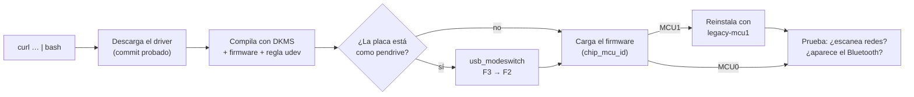

<p align="center"></p>

<h1 align="center">aic8800-wifi6-linux</h1>

<p align="center">
  <b>Español</b> · <a href="README.en.md">English</a><br><br>
  <a href="https://cafecito.app/matcarfer">☕ Cafecito</a> · <a href="https://www.matecito.co/matcarfer">🧉 Matecito</a> · <a href="https://link.mercadopago.com.ar/matcarfer">💙 Mercado Pago</a> · <a href="https://ko-fi.com/matcarfer">☕ Ko-fi</a> · <a href="https://www.patreon.com/matcarfer">❤ Patreon</a> · <a href="https://github.com/sponsors/matcarfer">💖 GitHub Sponsors</a>
</p>

<p align="center"><b>Hacé andar en Linux la placa USB WiFi 6 + Bluetooth que "aparece como pendrive", con un solo comando.</b></p>

```bash
curl -fsSL https://raw.githubusercontent.com/matcarfer/aic8800-wifi6-linux/main/install.sh | bash
```

Te pide tu contraseña, compila el driver (3 a 6 minutos) y termina así:

```
==> Buscando la placa...
  Está en modo pendrive (1111:1111). Cambiando a modo WiFi...
  ✓ Placa en modo WiFi (a69c:8d81)
  ✓ WiFi: wlan0 ve 31 redes
  ✓ Bluetooth: hci1

Listo. La placa se activa sola cada vez que la enchufes.
```

No hace falta desenchufar nada. Con cada kernel nuevo, el driver se recompila solo.

---

## ¿Es mi placa?

Seguramente sí, si al enchufarla en Linux **no aparece ninguna red nueva** pero sí **un pendrive o CD llamado "WiFi Driver"** con un `Wifi6_install.exe` adentro.

Para estar seguro, corré `lsusb`:

| `lsusb` muestra | Qué es |
|---|---|
| `1111:1111 Pandora International Ltd. 88M80` | AIC8800D80 en modo pendrive (genéricas "WIFI6", Lukton, AX900…) |
| `a69c:5721` … `a69c:5732` | AIC8800 en modo pendrive (Tenda, UGREEN, Cudy, BrosTrend…) |
| `a69c:8d80`, `a69c:8d81`, `368b:8d81`, … | La misma placa, ya en modo WiFi |

Se venden como **AX300, AX900, AX1800 o "WiFi 6 + Bluetooth 5.x"**: Tenda U11, UGREEN AX900, BrosTrend AX300/AX900, TP-Link TX1U Nano y muchas genéricas de Mercado Libre, AliExpress y Amazon. La lista completa de IDs está en [`install.sh`](install.sh) (`STORAGE_IDS` y `WIFI_IDS`).

## ¿Por qué no anda sola?

<details>
<summary>La explicación corta (abrir)</summary>

1. **Se hace pasar por pendrive.** Para que en Windows instales el driver sin CD, la placa arranca disfrazada de pendrive con el instalador `.exe`. Para que pase a ser placa WiFi hay que mandarle un comando especial: dos mensajes SCSI de AIC que terminan en `F3` y `F2`. Linux no los conoce.
2. **Linux no trae el driver.** El chip AIC8800 no está en el kernel oficial. Hay que compilar el driver, cargar el firmware del chip y volver a compilarlo con cada kernel nuevo.
3. **El Bluetooth necesita el firmware cargado** para aparecer. Después lo maneja el `btusb` normal de Linux.

Este repo resuelve las tres cosas con un comando. El detalle técnico está en [docs/ARCHITECTURE.es.md](docs/ARCHITECTURE.es.md).
</details>

## Cómo funciona



El driver es el de [shenmintao/aic8800d80](https://github.com/shenmintao/aic8800d80), que adapta a kernels nuevos el driver de Tenda/AICSemi. **Este repo no lo modifica**: lo descarga en una versión probada con placa real y le agrega lo que faltaba para que sea fácil.

| | Con el driver a mano | Con este repo |
|---|---|---|
| Pasos | clonar, `chmod`, `sudo`, desenchufar y enchufar | un comando |
| Omarchy / Limine | se queda en una pregunta oculta y parece colgado | resuelto, y nunca espera para siempre |
| Pendrive → WiFi | "desenchufá y volvé a enchufar" | lo hace solo |
| Rama `main` o `legacy-mcu1` | elegís vos sin saber cuál | lee `chip_mcu_id` y elige |
| Al final | "módulo cargado" | prueba que el WiFi vea redes y que el Bluetooth aparezca |
| Salida | unas 150 líneas en inglés | 6 líneas, en castellano o en inglés |

## Distros probadas

| Distro | Kernel | WiFi | Bluetooth | Placa | Fecha |
|---|---|---|---|---|---|
| Omarchy (Arch) | 7.2.15 | ✓ 2.4 + 5 GHz | ✓ | genérica "WIFI6" `1111:1111` 88M80 | 2026-11-26 |

Además, una CI semanal **compila el driver** contra el último kernel de Omarchy, Arch, Ubuntu y Fedora. Si algún kernel nuevo lo rompe, nos enteramos antes que vos.

**¿Lo probaste en otra distro o con otra placa?** [Contalo acá](../../issues/new?template=works.yml) (1 minuto) y la sumamos a la tabla.

En la comunidad de Omarchy: [post en Show and tell](https://github.com/omacom/omarchy/discussions/20296).

## Requisitos

- **Internet durante la instalación:** el WiFi de la notebook, cable o el celular compartiendo internet por USB.
- **Secure Boot desactivado.** Si está activado, el instalador te avisa y te explica qué hacer.
- Una distro con `apt`, `dnf`, `pacman` o `zypper`: Ubuntu, Debian, Mint, Pop!_OS, Fedora, Arch, Omarchy, CachyOS, Manjaro, EndeavourOS, openSUSE…

Los headers del kernel, `dkms` y `usb_modeswitch` se instalan solos.

## Desinstalar

```bash
curl -fsSL https://raw.githubusercontent.com/matcarfer/aic8800-wifi6-linux/main/uninstall.sh | bash
```

## Si algo falla

```bash
curl -fsSL https://raw.githubusercontent.com/matcarfer/aic8800-wifi6-linux/main/diagnose.sh | sudo bash
```

Genera `aic8800-diagnose.txt`. Solo lee, no cambia nada y tapa las MAC. [Abrí un issue](../../issues/new?template=error.yml) y adjuntalo.

<details>
<summary>Problemas comunes (abrir)</summary>

- **"No cambió de modo":** desenchufala, esperá 3 segundos y volvé a enchufarla. Algunos hubs USB cortan la corriente durante el cambio. Probá en un puerto directo de la computadora.
- **Anda después de reenchufar, pero no al arrancar:** reiniciá una vez. El initramfs ya incluye el firmware.
- **No aparece el Bluetooth:** algunas placas son solo WiFi.
- **Se corta o anda lento una vez instalada:** eso es del driver; reportalo en [shenmintao/aic8800d80](https://github.com/shenmintao/aic8800d80/issues).
- **Log completo:** `/var/log/aic8800-wifi6-linux.log`.
</details>

## Preguntas frecuentes

<details>
<summary>¿Es seguro <code>curl … | bash</code>?</summary>

Es tan seguro como el código que corre, y es corto: leelo antes en [`install.sh`](install.sh). El script no ejecuta nada hasta haberse descargado entero. El driver se baja en un **commit fijo** que probamos con una placa real, no "lo último que haya". Si preferís, cloná el repo y corré `./install.sh`.
</details>

<details>
<summary>¿Qué cambia en mi sistema?</summary>

- Driver en DKMS (`aic8800/1.0.0`) y código fuente en `/usr/local/src/aic8800-wifi6-linux`.
- Firmware en `/lib/firmware/aic8800*`.
- Regla udev `/etc/udev/rules.d/aic.rules` y `/etc/usb_modeswitch.d/1111:1111`.
- Paquetes: `dkms`, headers del kernel, `usb_modeswitch`.
- Regenera el initramfs.

`uninstall.sh` saca todo eso, salvo los paquetes.
</details>

<details>
<summary>¿Se rompe cuando actualizo el kernel u Omarchy?</summary>

DKMS recompila el driver solo con cada kernel nuevo. Una CI revisa todas las semanas que el driver compile con los kernels más nuevos, incluido `linux-omarchy`, y otra avisa cuando upstream publica cambios. Si Omarchy cambia cómo arma el arranque, el instalador detecta `limine-mkinitcpio`; si no lo encuentra, usa `mkinitcpio` normal. Además nunca espera una respuesta oculta: si algo se traba 45 minutos, corta y te avisa.
</details>

<details>
<summary>¿Raspberry Pi, ARM, Bazzite, Silverblue?</summary>

- **ARM (Raspberry Pi, Orange Pi…):** debería andar, porque el driver compila en ARM. Todavía no lo probamos.
- **Bazzite / Fedora Silverblue (sistemas inmutables):** este método no sirve. Mirá la [guía de upstream para Bazzite](https://github.com/shenmintao/aic8800d80/tree/main/bazzite).
</details>

## Colaborar

Toda ayuda suma, también la de asistentes de IA:

- **Probarlo** en tu distro y [contarlo](../../issues/new?template=works.yml).
- **Sumar una placa nueva:** [plantilla](../../issues/new?template=new-adapter.yml) o PR con el ID ([cómo](docs/MAINTAINING.es.md#sumar-una-placa)).
- **Código y docs:** [CONTRIBUTING.es.md](CONTRIBUTING.es.md) · [docs/ARCHITECTURE.es.md](docs/ARCHITECTURE.es.md) · [docs/MAINTAINING.es.md](docs/MAINTAINING.es.md).
- **Asistentes de IA (Claude, Codex, Copilot…):** empiecen por [AGENTS.md](AGENTS.md).

Seguimos el [código de conducta](CODE_OF_CONDUCT.es.md).

## Créditos

Este instalador es una capa fina sobre el trabajo de mucha gente: **[shenmintao](https://github.com/shenmintao/aic8800d80)** (el driver para kernels nuevos), **[Radxa](https://github.com/radxa-pkg/aic8800)**, **AICSemi** y **Tenda** (el driver original), **[a5a5aa555oo](https://github.com/radxa-pkg/aic8800/issues/68)** (descubrió los comandos `F3`/`F2` del modo pendrive), y otros. Lista completa en [CREDITS.es.md](CREDITS.es.md).

---

<sub>
Instalador: <a href="LICENSE">GPL-3.0-or-later</a> (<a href="LICENSE.en">texto oficial</a>), por matcarfer y colaboradores. El driver que se descarga es GPL-2.0 de sus autores.<br>
Todo se ofrece tal cual, sin garantía; usalo bajo tu responsabilidad. Las donaciones son voluntarias.
</sub>
